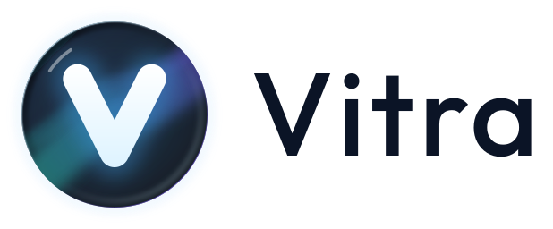
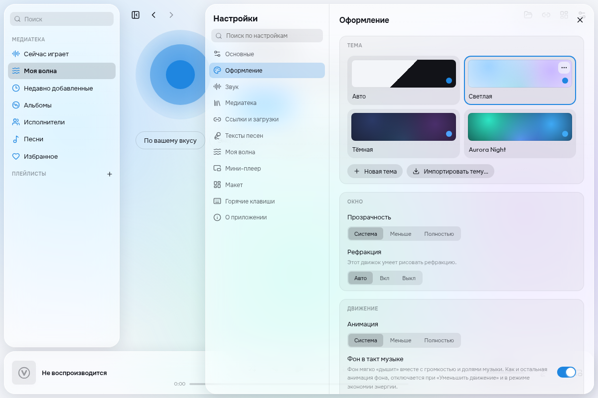

<p align="center">
  
</p>

[English](README.md) · Русский

Vitra — музыкальный плеер с открытым исходным кодом для macOS, Windows и Linux. Стеклянный
интерфейс Liquid Glass, настраиваемые темы и макеты, локальная медиатека, воспроизведение
по ссылкам и синхронизированные тексты песен.

> **Статус:** подготовка первого релиза, этап 11. Стабильный публичный релиз ещё не
> опубликован. Интеграции с Discord и Last.fm в этот релиз не входят.



Предпросмотр интерфейса в Chromium. Системные эффекты окна зависят от платформы.
[«Моя волна» на английском](docs/screenshots/my-wave-en.png).

## Установка проверочной сборки

Установщики размещаются в [GitHub Releases](https://github.com/Fil1825/vitra/releases).
Первый выпуск отмечается **Pre-release** — сборка для тестирования. Выберите файл для своей системы:
`Vitra-macOS-Apple-Silicon.dmg`, `Vitra-macOS-Intel.dmg`, `Vitra-Windows-x64.exe`
или `Vitra-Linux-x64.deb`. Публикация происходит после успешных проверок всех четырёх сборок.
Если выпуск ещё не появился, [проверьте ход сборки](https://github.com/Fil1825/vitra/actions/workflows/release.yml).

- **macOS:** откройте DMG и перенесите Vitra в «Программы». Apple Silicon требует macOS 14
  или новее, Intel — macOS 15 или новее. Сейчас используется локальная ad-hoc-подпись:
  она не является подписью Developer ID и не подтверждает доверие Gatekeeper.
- **Windows 10/11 x64:** запустите установщик NSIS. Текущие сборки не имеют Authenticode-подписи.
- **Ubuntu 24.04 / совместимый Debian x64:** установите пакет командой
  `sudo apt install ./Vitra-Linux-x64.deb`. Системный mpv устанавливается как зависимость.

yt-dlp, FFmpeg, ffprobe и Deno входят в пакеты; в macOS и Windows также включён mpv.
Слушателю не нужны Rust, Node.js или инструменты разработчика. План подписи и проверки на
чистой системе описан в [руководстве по релизу](docs/RELEASING.md).

## Медиатека и воспроизведение

Добавьте папки с музыкой: Vitra следит за изменениями и собирает альбомы, исполнителей,
плейлисты и избранное. Есть очередь, поиск, история и восстановление сессии. Файлы и папки
можно перетаскивать в окно. Обложки альбомов, исполнителей и плейлистов можно выбирать
самостоятельно.

Вставьте ссылку в окно или нажмите ⌘U / Ctrl+U: поддерживаются YouTube, YouTube Music,
SoundCloud, прямые ссылки на аудио и интернет-радио. Воспроизводится только звук. Трек
можно скачать в оригинальном формате, MP3 или FLAC с обложкой и тегами. В настройках
загрузок можно обновить yt-dlp и выбрать браузер с авторизацией для источников, требующих
входа. Поддержка сайтов зависит от yt-dlp и может меняться.

## Импорт плейлистов

Импортируйте списки треков из Spotify, Apple Music, Deezer и Яндекс Музыки по ссылке,
из M3U, XSPF, CSV и XML, либо вставьте текст «Исполнитель — Название». На Mac доступен
импорт из приложения «Музыка». Переносится список: песни из своей медиатеки играют сразу,
остальные ищутся в YouTube Music. Неуверенное совпадение можно выбрать вручную.

## Моя волна

Бесконечная очередь под настроение: «Ваш вкус», энергичная, спокойная, грустная или похожая
на выбранный трек. Анализируется звучание музыки, а предпочтения уточняются по избранному,
пропускам и отметкам «Не нравится». По желанию радио YouTube Music добавляет похожие песни,
когда заканчиваются подходящие треки в медиатеке.

В настройках «Моей волны» можно приостановить анализ, отключить анализ ссылок и радио.
HTTPS-потоки используют системные сертификаты; повторяющиеся ошибки декодирования видны
в настройках, а не только в журнале.

## Тексты песен

Vitra читает тексты из тегов и соседних LRC-файлов, подсвечивает строки и слова с временными
метками. Щелчок по строке перематывает песню. Можно редактировать текст, расставлять
тайминги пробелом и сохранять результат в теги с резервной копией, LRC или базу плеера.
Поиск в LRCLIB включается отдельно и передаёт этому сервису метаданные песни.

## Оформление и мини-плеер

Светлая, тёмная, Aurora Night и пользовательские темы; редактор с живым предпросмотром;
импорт и экспорт `.vitratheme`. Панели можно перемещать, изменять их размер и сохранять
макеты. Учитываются настройки уменьшения движения и энергосбережения.

Мини-плеер открывается сочетанием ⌥⌘M / Ctrl+Alt+M или кнопкой: компактный режим, узкая
полоска или строка текста. Есть закрепление поверх окон, привязка к краям и прозрачность.

## Звук и управление

Десятиполосный эквалайзер, нормализация громкости и плавный переход между песнями.
Поддерживаются медиаклавиши, системная панель воспроизведения, значок в строке меню или
трее и настраиваемые глобальные сочетания клавиш.

## Сборка из исходников

Нужны стабильный Rust, Node.js 22.12+ и [зависимости Tauri](https://v2.tauri.app/start/prerequisites/).
В Linux установите системный mpv.

```sh
npm ci
npm run fetch-sidecars -- --require-checksums
npm run check:all
npm run tauri dev
```

Для установщика со вспомогательными программами используйте `npm run bundle`.
Обычная сборка `npm run tauri build` не включает скачанные компоненты.
[Участие в разработке](CONTRIBUTING.md), [создание тем](docs/THEMES.md),
[проверка HTTPS](docs/TLS.md).

## Условия использования и лицензия

Пользователь отвечает за соблюдение правил используемых сайтов и законодательства об
авторском праве. Проект распространяется под [GPL-3.0-or-later](LICENSE). В оформлении
не используются иконки, логотипы и шрифты Apple. Шрифты Outfit и Onest включены по
лицензии SIL Open Font License.
