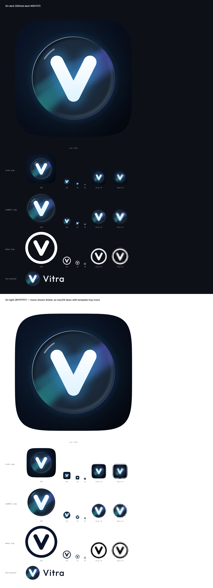

# Vitra brand — "Night Ice + Aurora"

Looking through a piece of ice at the northern lights on a polar night: cold, dark, calm.
A rounded tile, a thick glass lens, a bold rounded "V".



## Files

| File                        | Use                                                                                  |
| --------------------------- | ------------------------------------------------------------------------------------ |
| `icon.svg`                  | App icon (squircle tile + lens + V). Source of every app icon size.                  |
| `icon-1024.png`             | 1024 × 1024 export of `icon.svg`, input for `npm run tauri icon`.                    |
| `symbol.svg`                | Lens + V on a transparent background (the lens carries its own night sky).           |
| `mono.svg`                  | Flat white silhouette (lens outline + V): tray / menu bar (template image), favicon. |
| `logo-horizontal-dark.svg`  | Symbol + "Vitra" wordmark for dark backgrounds.                                      |
| `logo-horizontal-light.svg` | Same, with dark navy text for light backgrounds.                                     |
| `preview.png`               | Readability check at 1024/256/64/32/16 px; 32 and 16 px are also shown magnified.    |

Regenerating the app icons after changing `icon.svg`: export it to `icon-1024.png` at
1024 × 1024 with a transparent background, then

```sh
npm run tauri icon -- assets/brand/icon-1024.png
rm -rf src-tauri/icons/android src-tauri/icons/ios src-tauri/icons/Square*Logo.png src-tauri/icons/StoreLogo.png
```

## Palette

Three accents plus white and dark navy — nothing else.

| Token           | Hex       | Role                                                 |
| --------------- | --------- | ---------------------------------------------------- |
| `night-top`     | `#0B1426` | Tile gradient, top-left; Aurora Night surface        |
| `night-bottom`  | `#05070D` | Tile gradient, bottom-right; Aurora Night background |
| `aurora-teal`   | `#2EE6C5` | Aurora start                                         |
| `ice`           | `#3FA9F5` | Aurora middle, bloom and glows; Aurora Night accent  |
| `aurora-violet` | `#7B5CFF` | Aurora end, bottom-right lens rim                    |
| `rim`           | `#CFEFFF` | Icy highlight on the lens rim (a tint of `ice`)      |
| `white`         | `#FFFFFF` | V (top), specular, glass fill at 6 %                 |
| `ice-white`     | `#DDF3FF` | V (bottom)                                           |
| `ink-light`     | `#F2F8FF` | Wordmark on dark backgrounds                         |
| `ink-dark`      | `#0B1426` | Wordmark on light backgrounds                        |

The **Aurora Night** built-in theme (stage 1, together with the theme token system) uses the
same values: `night-bottom` background, `night-top` glass tint, `ice` accent, and the
`aurora-teal → ice → aurora-violet` gradient as the flowing background when no artwork is
playing.

## Construction (1024 px grid)

- Tile: superellipse (n = 5), 880 px, centered; gradient `night-top` → `night-bottom`
  (top-left → bottom-right); `ice` bloom at 12 % behind the lens, clipped to the tile.
- Lens: r = 312, white fill at 6 %; aurora ribbon at ~40 % (soft blur) clipped to the lens;
  2 px `rim` highlight fading from the top-left, faint violet rim bottom-right; darker inner
  edge top-left and a soft caustic bottom-right give it thickness; a small specular arc; a faint
  `ice` outer glow.
- V: stroke 98 px, round caps and join, vertical gradient `white` → `ice-white`, soft `ice`
  glow behind it inside the lens.
- Mono: ring r = 440 / stroke 80, V stroke 118 — about 1.25 px and 1.8 px at 16 px.

## Wordmark

[Outfit](https://github.com/Outfitio/Outfit-Fonts) Medium (500), +4 % letter spacing, converted
to outlines so the logo renders identically everywhere. Outfit is licensed under the
[SIL Open Font License 1.1](https://openfontlicense.org).

## Rules

- Don't recolor the symbol, add outlines, sparkles, noise or 3D effects.
- Keep clear space around the symbol of at least a quarter of the lens diameter.
- Use `mono.svg` for the tray / menu bar and favicons; the full-color icon is for app icons.
- No Apple, Apple Music, Spotify or other brands' assets or look-alikes.
